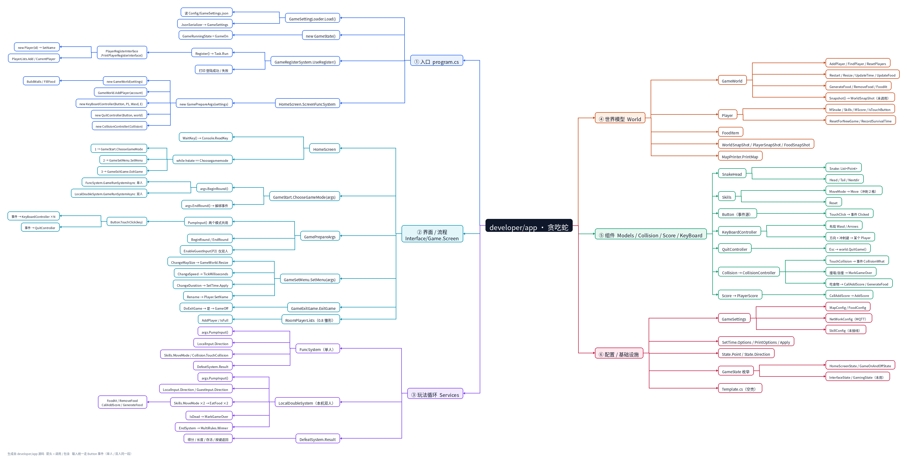
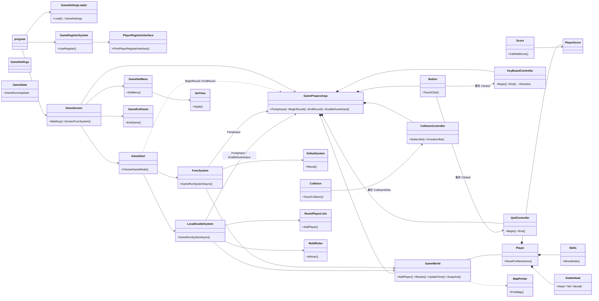

# developer/app 代码结构与调用思维导图



> - 图片版：[`代码结构思维导图.png`](代码结构思维导图.png)（3630 × 1833，箭头方向 = 调用 / 包含）
> - 生成脚本：[`tools/gen_mindmap.py`](tools/gen_mindmap.py)，改完代码执行 `python3 tools/gen_mindmap.py` 即可同步
> - 可编辑版：把 §5 的缩进列表整段粘到 XMind / MindNode / 幕布里
> - 图的左半边分支是镜像布局，从右往左读

---

## 1. 分层总览

| 层 | 目录 | 主要类型 | 职责 | 依赖方向 |
| --- | --- | --- | --- | --- |
| 入口 | `program.cs` | 顶层语句 | 装配配置 → 登录 → 大厅循环 | 向下 |
| 界面 / 流程 | `Interface/Game.Screen`、`Interface/Game.Register`、`Interface/State` | `HomeScreen`、`GameStart`、`GameSetMenu`、`GameExitGame`、`GamePrepareArgs`、`PlayerRegisterInterface`、`GameState` | 菜单状态机、房间座位、登录 | 向下 |
| 玩法循环 | `Services`、`GameTime` | `FuncSystem`、`LocalDoubleSystem`、`DefeatSystem`、`SetTime` | 一帧一帧推进世界、判胜负、结算 | 向下 |
| 世界模型 | `World` | `GameWorld`、`Player`、`FoodItem`、`WorldSnapShot`、`MapPrinter` | 地图/食物/玩家/快照/渲染 | 向下 |
| 组件 | `Models/Snake`、`GameCollision`、`GameScore`、`KeyBoard` | `SnakeHead`、`Skills`、`Collision`、`Score`、`Button`、`KeyBoardController`、`QuitController` | 蛇身、技能、碰撞、计分、按键 | 平级 |
| 配置 / 基础 | `Config`、`Services/State.cs` | `GameSettings` 及子配置、`GameSettingLoader`、`State.Point/Direction` | JSON 配置与通用数据结构 | 无 |

---

## 2. 按键事件：单人与双人共用一条管线

```text
                      ┌──────────── 单人 ────────────┐
Console.KeyAvailable → args.PumpInput() → Button.TouchClick(key)
                      └────────── 本机双人 ────────────┘
                                     │  事件 Clicked
        ┌────────────────────────────┼────────────────────────────┐
        ▼                            ▼                            ▼
KeyBoardController(P1, Wasd, E)  KeyBoardController(P2, Arrows, 0)  QuitController
        │                            │                            │
   P1 方向 / 冲刺                P2 方向 / 冲刺                Esc → world.QuitGame()
```

要点：

- `Button` 只负责“把这一帧的按键发出去”，不再关心是谁；
- **布局只是参数**（`KeyLayout.Wasd` / `KeyLayout.Arrows`），每个玩家一套控制器，各自只认自己那套键；
- 单人 = 1 个方向控制器 + 1 个退出控制器；双人 = 2 个方向控制器 + 1 个退出控制器；
- 两个模式的循环里现在是同一段代码：

```csharp
args.PumpInput();                       // 按键全部交给 Button 事件
if (world.QuitRequired) break;          // Esc 由 QuitController 统一处理
player.MSnake.Nextdir = args.LocalInput.Direction;
```

---

## 3. 类关系图



---

## 4. 关键调用链

### 4.1 启动

```text
program.cs
 ├─ GameSettingLoader.Load()            → Config/GameSettings.json → GameSettings
 ├─ new GameState()                     → GameRunningState = GameOn
 └─ while (GameOn)
     ├─ GameRegisterSystem.UseRegister()
     │   └─ Register() → Task.Run(PlayerRegisterInterface.PrintPlayerRegisterInterface)
     │        ├─ new Player(id) → SetName
     │        └─ PlayerLists.Add / CurrentPlayer
     └─ HomeScreen.ScreenFuncSystem(state, settings)
         └─ new GamePrepareArgs(settings)
              ├─ account = PlayerRegisterInterface.CurrentPlayer ?? new Player("local")
              ├─ new GameWorld(settings)                 → BuildWalls / FillFood
              ├─ new KeyBoardController(Button, P1, Wasd, E)
              ├─ new QuitController(Button, world)
              └─ new CollisionController(Collision)
```

### 4.2 一局（单人与双人对称）

```text
HomeScreen.ScreenFuncSystem  while (hstate == Choosegamemode)
 ├─ WaitKey() ─ 1 → GameStart.ChooseGameMode(args)
 │      ├─ args.BeginRound()         ResetPlayers → AddPlayer → Restart
 │      │                            → LocalInput.Begin / quit.Begin / Collision.Subscribe
 │      ├─ FuncSystem.GameRunSystemAsync(args)          ← 单人
 │      │    └─ loop: args.PumpInput() → LocalInput.Direction
 │      │             → Skills.MoveMode → Collision.TouchCollision
 │      │             → world.PrintMap → DefeatSystem.Result
 │      ├─ LocalDoubleSystem.GameRunSystemAsync(args)   ← 本机双人
 │      │    ├─ EnableGuestInput(p2)   ← 玩家2 挂方向键
 │      │    └─ loop: args.PumpInput() → LocalInput.Direction / GuestInput.Direction
 │      │             → Skills.MoveMode ×2 → EatFood ×2
 │      │             → IsDead → EndSystem → MultiRules.Winner
 │      └─ args.EndRound()           LocalInput.End / GuestInput.End / quit.End / Unsubscribe
 ├─ WaitKey() ─ 2 → GameSetMenu.SetMenu(args)
 │      ├─ ChangeMapSize  → GameWorld.Resize
 │      ├─ ChangeSpeed    → GameWorld.TickMilliseconds
 │      ├─ ChangeDuration → SetTime.PrintOptions / SetTime.Apply
 │      └─ Rename         → Player.SetName
 └─ WaitKey() ─ 3 → GameExitGame.ExitGame(state) → GameOff → 退出循环
```

### 4.3 事件订阅的生命周期

```text
GamePrepareArgs
 ├─ BeginRound()   LocalInput.Begin(dir)      button.Clicked += OnClicked   (P1)
 │                 quit.Begin()               button.Clicked += OnClicked   (Esc)
 │                 Collision.Subscribe()      collision.CollisionWhat += OnCollision
 ├─ EnableGuestInput(p2)  GuestInput.Begin()  button.Clicked += OnClicked   (P2，仅双人)
 └─ EndRound()     全部 -= 解绑，GuestInput 置空
```

> 不重新挂就会“蛇不动、不判死”，不摘掉就会一帧触发多次——这两个坑在 0.5 阶段都踩过。

---

## 5. 未接线的部分（改代码前先确认）

| 类型 / 成员 | 现状 |
| --- | --- |
| `GameWorld.Snapshot()`、`WorldSnapShot` / `PlayerSnapShot` / `FoodSnapShot` | 已实现但无人调用，0.6 网络层用 |
| `GameState.InterfaceState`、`State.GamingState` | 枚举已定义但没人用，可删 |
| `Services/Template.cs` | 整份注释掉的模板，不参与编译 |
| `GameSettings.SkillConfig`、`SkillConfig` | 读了 JSON 但 `Skills` 里还是硬编码 5 秒冷却 |
| `RoomPlayerLists` | 只在双人开局占两个座位，0.8 联机房间再扩 |

---

## 6. 大纲（可直接导入 XMind）

```text
developer/app · 贪吃蛇
    ① 入口 program.cs
        GameSettingLoader.Load() → Config/GameSettings.json → GameSettings
        new GameState() → GameRunningState
        GameRegisterSystem.UseRegister() → Register() → PlayerRegisterInterface.PrintPlayerRegisterInterface
            new Player(id) → SetName
            PlayerLists / CurrentPlayer
        HomeScreen.ScreenFuncSystem → new GamePrepareArgs
            new GameWorld → BuildWalls / FillFood
            KeyBoardController / QuitController / CollisionController
    ② 界面 / 流程
        HomeScreen: WaitKey / while hstate
        GamePrepareArgs: PumpInput / BeginRound / EndRound / EnableGuestInput
        GameStart.ChooseGameMode → BeginRound → 单人 / 双人 → EndRound
        GameSetMenu: 地图 / 速度 / 时长 / 改名
        GameExitGame: DoExitGame → GameOff
        RoomPlayerLists: AddPlayer / IsFull
    ③ 玩法循环
        FuncSystem（单人）: PumpInput → LocalInput.Direction → MoveMode → TouchCollision → PrintMap → DefeatSystem.Result
        LocalDoubleSystem（本机双人）: PumpInput → Local/Guest 两个方向 → MoveMode ×2 → EatFood ×2 → IsDead → EndSystem → MultiRules.Winner
        DefeatSystem.Result → 得分 / 长度 / 存活
    ④ 世界模型
        GameWorld: AddPlayer / FindPlayer / Restart / Resize / UpdateTime / UpdateFood
        GameWorld: GenerateFood / RemoveFood / FoodAt / Snapshot
        Player: MSnake / Skills / MScore / IsTouchButton / ResetForNewGame
        FoodItem / WorldSnapShot / PlayerSnapShot / FoodSnapShot
        MapPrinter.PrintMap
    ⑤ 组件
        SnakeHead: Snake / Head / Tail / Nextdir
        Skills: MoveMode / Move / Reset
        Button: TouchClick → 事件 Clicked
        KeyBoardController: 布局 Wasd / Arrows，方向 + 冲刺键
        QuitController: Esc → QuitGame
        Collision → CollisionController: 撞墙判死 / 吃食物 / 计分
        Score → PlayerScore: CallAddScore / AddScore
    ⑥ 配置 / 基础设施
        GameSettings: MapConfig / FoodConfig / NetWorkConfig / SkillConfig
        SetTime: Options / PrintOptions / Apply
        State.Point / State.Direction
        GameState 枚举: HomeScreenState / GameOnAndOffState / InterfaceState（未用）
```

---

## 7. 文件清单

| 文件 | 行数 | 说明 |
| --- | ---: | --- |
| `program.cs` | 17 | 入口 |
| `Config/GameSettings.cs` | 39 | 配置模型 |
| `Config/GameSettingLoader.cs` | 53 | JSON 读取与校验 |
| `Interface/State/Game.State.cs` | 27 | `GameState` 与三个枚举 |
| `Interface/Game.Register/Game.RegisterInterface.cs` | 44 | 注册界面与账号列表 |
| `Interface/Game.Register/GameRegisterSystem.cs` | 30 | 登录流程 |
| `Interface/Game.Screen/Game.Screen.cs` | 49 | 主菜单 + `WaitKey` |
| `Interface/Game.Screen/Game.Start.cs` | 53 | 模式选择与开局 |
| `Interface/Game.Screen/Game.SetMenu.cs` | 126 | 设置菜单 |
| `Interface/Game.Screen/Game.ExitGame.cs` | 40 | 退出确认 |
| `Interface/Game.Screen/Game.Args.cs` | 93 | 局上下文、输入分发、事件装配 |
| `Interface/Game.Screen/Game.PlayerLists.cs` | 35 | 房间座位 |
| `Interface/Game.Screen/Game.End.cs` | 47 | `MultiRules.Winner` |
| `Services/System.cs` | 67 | 单人循环 |
| `Services/LocalDoubleSystem.cs` | 176 | 本机双人循环 |
| `Services/Die.cs` | 23 | 单人结算 |
| `Services/State.cs` | 21 | `Point` / `Direction` |
| `Services/Template.cs` | 30 | 空壳（全注释） |
| `GameTime/ChangeTime.cs` | 35 | 时长预设 `SetTime` |
| `World/GameWorld.cs` | 212 | 世界 |
| `World/Player.cs` | 42 | 玩家 |
| `World/FoodItem.cs` | 5 | 食物结构体 |
| `World/View.cs` | 30 | 地图渲染 |
| `World/WorldSnapShot.cs` | 29 | 快照记录 |
| `Models/Snake/Snake.cs` | 38 | 蛇身 |
| `Models/Snake/Skills.cs` | 48 | 冲刺技能 |
| `GameCollision/Collision.cs` | 65 | 碰撞事件与控制器 |
| `GameScore/Score.cs` | 22 | 计分 |
| `KeyBoard/KeyBoard.cs` | 21 | `Button` 事件源 |
| `KeyBoard/MoveButton.cs` | 55 | `KeyBoardController` + `KeyLayout` |
| `KeyBoard/QuitButton.cs` | 21 | `QuitController`（Esc） |
| `tools/gen_mindmap.py` | — | 本图生成脚本 |
