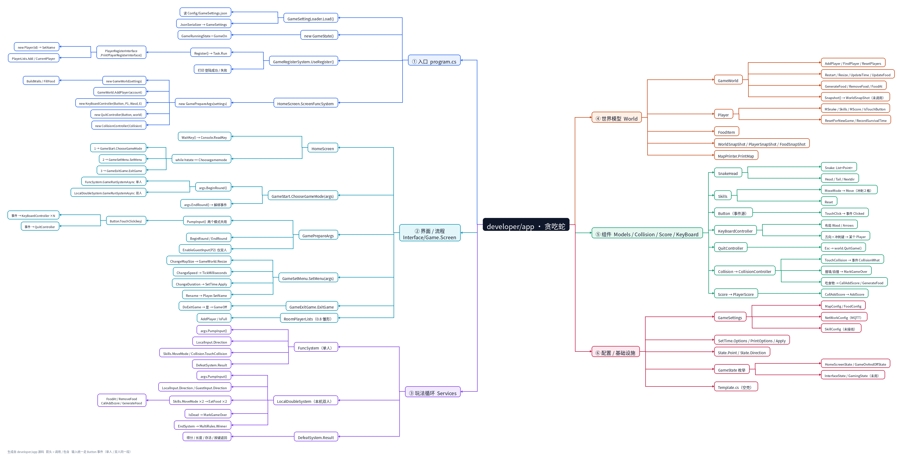
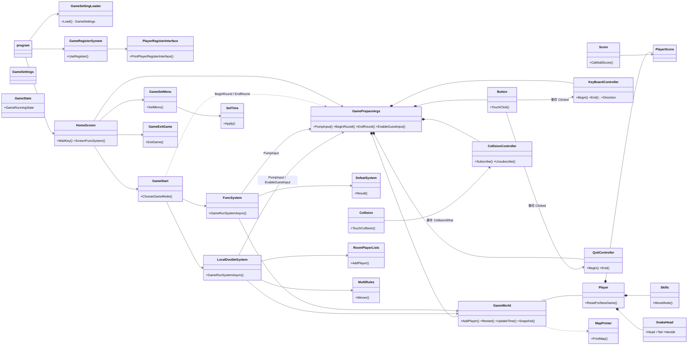

# developer/app 代码结构与调用思维导图



> - 图片版：[`代码结构思维导图.png`](代码结构思维导图.png)（3630 × 1833，箭头方向 = 调用 / 包含）
> - 图片版是 2026-10 的快照；生成脚本已移除，后续以文档中的表格/大纲为准
> - 可编辑版：把 §5 的缩进列表整段粘到 XMind / MindNode / 幕布里
> - 图的左半边分支是镜像布局，从右往左读
> - 改进任务见 **§8（7 个改进任务：思路 + 代码示例）**
> - 2026-11-07：8.1 进行中（Round.cs 已有骨架，见 §8.1）；8.6 决定暂不做；目录/文件变动见 §9
> - 注：§1 / §7 里的旧路径（Interface/、KeyBoard/、GameCollision/）已在 2026-11 重组为 Services/Interface、Services/KeyBoard、GameConfig/，以实际代码为准

---

## 1. 分层总览

| 层 | 目录 | 主要类型 | 职责 | 依赖方向 |
| --- | --- | --- | --- | --- |
| 入口 | `program.cs` | 顶层语句 | 装配配置 → 登录 → 大厅循环 | 向下 |
| 界面 / 流程 | `Interface/Game.Screen`、`Interface/Game.Register`、`Interface/State` | `HomeScreen`、`GameStart`、`GameSetMenu`、`GameExitGame`、`GamePrepareArgs`、`PlayerRegisterInterface`、`GameState` | 菜单状态机、房间座位、登录 | 向下 |
| 玩法循环 | `Services`、`GameTime` | `FuncSystem`、`LocalDoubleSystem`、`DefeatSystem`、`SetTime` | 一帧一帧推进世界、判胜负、结算 | 向下 |
| 世界模型 | `World` | `GameWorld`、`Player`、`FoodItem`、`WorldSnapShot`、`MapPrinter` | 地图/食物/玩家/快照/渲染 | 向下 |
| 组件 | `Models/Snake`、`GameCollision`、`GameScore`、`KeyBoard` | `SnakeHead`、`Skills`、`Collision`、`Score`、`Button`、`KeyBoardController`、`QuitController` | 蛇身、技能、碰撞、计分、按键 | 平级 |
| 配置 / 基础 | `Config`、`Services/State.cs` | `GameSettings` 及子配置、`GameSettingLoader`、`State.Point/Direction` | JSON 配置与通用数据结构 | 无 |

---

## 2. 按键事件：单人与双人共用一条管线

```text
                      ┌──────────── 单人 ────────────┐
Console.KeyAvailable → args.PumpInput() → Button.TouchClick(key)
                      └────────── 本机双人 ────────────┘
                                     │  事件 Clicked
        ┌────────────────────────────┼────────────────────────────┐
        ▼                            ▼                            ▼
KeyBoardController(P1, Wasd, E)  KeyBoardController(P2, Arrows, 0)  QuitController
        │                            │                            │
   P1 方向 / 冲刺                P2 方向 / 冲刺                Esc → world.QuitGame()
```

要点：

- `Button` 只负责“把这一帧的按键发出去”，不再关心是谁；
- **布局只是参数**（`KeyLayout.Wasd` / `KeyLayout.Arrows`），每个玩家一套控制器，各自只认自己那套键；
- 单人 = 1 个方向控制器 + 1 个退出控制器；双人 = 2 个方向控制器 + 1 个退出控制器；
- 两个模式的循环里现在是同一段代码：

```csharp
args.PumpInput();                       // 按键全部交给 Button 事件
if (world.QuitRequired) break;          // Esc 由 QuitController 统一处理
player.MSnake.Nextdir = args.LocalInput.Direction;
```

---

## 3. 类关系图



---

## 4. 关键调用链

### 4.1 启动

```text
program.cs
 ├─ GameSettingLoader.Load()            → Config/GameSettings.json → GameSettings
 ├─ new GameState()                     → GameRunningState = GameOn
 └─ while (GameOn)
     ├─ GameRegisterSystem.UseRegister()
     │   └─ Register() → Task.Run(PlayerRegisterInterface.PrintPlayerRegisterInterface)
     │        ├─ new Player(id) → SetName
     │        └─ PlayerLists.Add / CurrentPlayer
     └─ HomeScreen.ScreenFuncSystem(state, settings)
         └─ new GamePrepareArgs(settings)
              ├─ account = PlayerRegisterInterface.CurrentPlayer ?? new Player("local")
              ├─ new GameWorld(settings)                 → BuildWalls / FillFood
              ├─ new KeyBoardController(Button, P1, Wasd, E)
              ├─ new QuitController(Button, world)
              └─ new CollisionController(Collision)
```

### 4.2 一局（单人与双人对称）

```text
HomeScreen.ScreenFuncSystem  while (hstate == Choosegamemode)
 ├─ WaitKey() ─ 1 → GameStart.ChooseGameMode(args)
 │      ├─ args.BeginRound()         ResetPlayers → AddPlayer → Restart
 │      │                            → LocalInput.Begin / quit.Begin / Collision.Subscribe
 │      ├─ FuncSystem.GameRunSystemAsync(args)          ← 单人
 │      │    └─ loop: args.PumpInput() → LocalInput.Direction
 │      │             → Skills.MoveMode → Collision.TouchCollision
 │      │             → world.PrintMap → DefeatSystem.Result
 │      ├─ LocalDoubleSystem.GameRunSystemAsync(args)   ← 本机双人
 │      │    ├─ EnableGuestInput(p2)   ← 玩家2 挂方向键
 │      │    └─ loop: args.PumpInput() → LocalInput.Direction / GuestInput.Direction
 │      │             → Skills.MoveMode ×2 → EatFood ×2
 │      │             → IsDead → EndSystem → MultiRules.Winner
 │      └─ args.EndRound()           LocalInput.End / GuestInput.End / quit.End / Unsubscribe
 ├─ WaitKey() ─ 2 → GameSetMenu.SetMenu(args)
 │      ├─ ChangeMapSize  → GameWorld.Resize
 │      ├─ ChangeSpeed    → GameWorld.TickMilliseconds
 │      ├─ ChangeDuration → SetTime.PrintOptions / SetTime.Apply
 │      └─ Rename         → Player.SetName
 └─ WaitKey() ─ 3 → GameExitGame.ExitGame(state) → GameOff → 退出循环
```

### 4.3 事件订阅的生命周期

```text
GamePrepareArgs
 ├─ BeginRound()   LocalInput.Begin(dir)      button.Clicked += OnClicked   (P1)
 │                 quit.Begin()               button.Clicked += OnClicked   (Esc)
 │                 Collision.Subscribe()      collision.CollisionWhat += OnCollision
 ├─ EnableGuestInput(p2)  GuestInput.Begin()  button.Clicked += OnClicked   (P2，仅双人)
 └─ EndRound()     全部 -= 解绑，GuestInput 置空
```

> 不重新挂就会“蛇不动、不判死”，不摘掉就会一帧触发多次——这两个坑在 0.5 阶段都踩过。

---

## 5. 未接线的部分（改代码前先确认）

| 类型 / 成员 | 现状 |
| --- | --- |
| `GameWorld.Snapshot()`、`WorldSnapShot` / `PlayerSnapShot` / `FoodSnapShot` | 已实现但无人调用，0.6 网络层用 |
| `GameState.InterfaceState`、`State.GamingState` | 枚举已定义但没人用，可删 |
| `Services/Template.cs` | 整份注释掉的模板，不参与编译 |
| `GameSettings.SkillConfig`、`SkillConfig` | 读了 JSON 但 `Skills` 里还是硬编码 5 秒冷却 |
| `RoomPlayerLists` | 只在双人开局占两个座位，0.8 联机房间再扩 |

---

## 6. 大纲（可直接导入 XMind）

```text
developer/app · 贪吃蛇
    ① 入口 program.cs
        GameSettingLoader.Load() → Config/GameSettings.json → GameSettings
        new GameState() → GameRunningState
        GameRegisterSystem.UseRegister() → Register() → PlayerRegisterInterface.PrintPlayerRegisterInterface
            new Player(id) → SetName
            PlayerLists / CurrentPlayer
        HomeScreen.ScreenFuncSystem → new GamePrepareArgs
            new GameWorld → BuildWalls / FillFood
            KeyBoardController / QuitController / CollisionController
    ② 界面 / 流程
        HomeScreen: WaitKey / while hstate
        GamePrepareArgs: PumpInput / BeginRound / EndRound / EnableGuestInput
        GameStart.ChooseGameMode → BeginRound → 单人 / 双人 → EndRound
        GameSetMenu: 地图 / 速度 / 时长 / 改名
        GameExitGame: DoExitGame → GameOff
        RoomPlayerLists: AddPlayer / IsFull
    ③ 玩法循环
        FuncSystem（单人）: PumpInput → LocalInput.Direction → MoveMode → TouchCollision → PrintMap → DefeatSystem.Result
        LocalDoubleSystem（本机双人）: PumpInput → Local/Guest 两个方向 → MoveMode ×2 → EatFood ×2 → IsDead → EndSystem → MultiRules.Winner
        DefeatSystem.Result → 得分 / 长度 / 存活
    ④ 世界模型
        GameWorld: AddPlayer / FindPlayer / Restart / Resize / UpdateTime / UpdateFood
        GameWorld: GenerateFood / RemoveFood / FoodAt / Snapshot
        Player: MSnake / Skills / MScore / IsTouchButton / ResetForNewGame
        FoodItem / WorldSnapShot / PlayerSnapShot / FoodSnapShot
        MapPrinter.PrintMap
    ⑤ 组件
        SnakeHead: Snake / Head / Tail / Nextdir
        Skills: MoveMode / Move / Reset
        Button: TouchClick → 事件 Clicked
        KeyBoardController: 布局 Wasd / Arrows，方向 + 冲刺键
        QuitController: Esc → QuitGame
        Collision → CollisionController: 撞墙判死 / 吃食物 / 计分
        Score → PlayerScore: CallAddScore / AddScore
    ⑥ 配置 / 基础设施
        GameSettings: MapConfig / FoodConfig / NetWorkConfig / SkillConfig
        SetTime: Options / PrintOptions / Apply
        State.Point / State.Direction
        GameState 枚举: HomeScreenState / GameOnAndOffState / InterfaceState（未用）
```

---

## 7. 文件清单

| 文件 | 行数 | 说明 |
| --- | ---: | --- |
| `program.cs` | 17 | 入口 |
| `Config/GameSettings.cs` | 39 | 配置模型 |
| `Config/GameSettingLoader.cs` | 53 | JSON 读取与校验 |
| `Interface/State/Game.State.cs` | 27 | `GameState` 与三个枚举 |
| `Interface/Game.Register/Game.RegisterInterface.cs` | 44 | 注册界面与账号列表 |
| `Interface/Game.Register/GameRegisterSystem.cs` | 30 | 登录流程 |
| `Interface/Game.Screen/Game.Screen.cs` | 49 | 主菜单 + `WaitKey` |
| `Interface/Game.Screen/Game.Start.cs` | 53 | 模式选择与开局 |
| `Interface/Game.Screen/Game.SetMenu.cs` | 126 | 设置菜单 |
| `Interface/Game.Screen/Game.ExitGame.cs` | 40 | 退出确认 |
| `Interface/Game.Screen/Game.Args.cs` | 93 | 局上下文、输入分发、事件装配 |
| `Interface/Game.Screen/Game.PlayerLists.cs` | 35 | 房间座位 |
| `Interface/Game.Screen/Game.End.cs` | 47 | `MultiRules.Winner` |
| `Services/System.cs` | 67 | 单人循环 |
| `Services/LocalDoubleSystem.cs` | 176 | 本机双人循环 |
| `Services/Die.cs` | 23 | 单人结算 |
| `Services/State.cs` | 21 | `Point` / `Direction` |
| `Services/Template.cs` | 30 | 空壳（全注释） |
| `GameTime/ChangeTime.cs` | 35 | 时长预设 `SetTime` |
| `World/GameWorld.cs` | 212 | 世界 |
| `World/Player.cs` | 42 | 玩家 |
| `World/FoodItem.cs` | 5 | 食物结构体 |
| `World/View.cs` | 30 | 地图渲染 |
| `World/WorldSnapShot.cs` | 29 | 快照记录 |
| `Models/Snake/Snake.cs` | 38 | 蛇身 |
| `Models/Snake/Skills.cs` | 48 | 冲刺技能 |
| `GameCollision/Collision.cs` | 65 | 碰撞事件与控制器 |
| `GameScore/Score.cs` | 22 | 计分 |
| `KeyBoard/KeyBoard.cs` | 21 | `Button` 事件源 |
| `KeyBoard/MoveButton.cs` | 55 | `KeyBoardController` + `KeyLayout` |
| `KeyBoard/QuitButton.cs` | 21 | `QuitController`（Esc） |
| `tools/gen_mindmap.py` | — | 本图生成脚本 |
---

## 8. 七个改进任务（改造清单 + 代码示例）

> 来自 2026-11-06 的整体框架评审。每个任务都给了**现状 → 思路 → 代码示例 → 验收**。
> 任务之间基本独立，建议按 8.1 → 8.7 的顺序做（先低风险整理，再动架构）。

### 8.0 总表

| # | 任务 | 收益 | 成本 | 风险 | 建议顺序 |
| --- | --- | --- | --- | --- | --- |
| 8.1 | 单人/双人循环合并成 RoundRunner | 消灭两份重复循环 | 中 | 中 | 2 |
| 8.2 | 输入改成 PlayerIntent | 网络输入不再伪装键盘 | 中高 | 中高 | 3 |
| 8.3 | 拆分 NetHost | 去掉静态大杂烩，生命周期可收口 | 中 | 中 | 4 |
| 8.4 | 领域层去 Console | 可测试、可换 UI | 中 | 中 | 5 |
| 8.5 | 配置与运行态分离 | 设置/重开行为一致 | 中 | 中 | 6 |
| 8.6 | 精简事件 | ⏸ 暂不做（Collision 保持现状） | — | — | — |
| 8.7 | 目录/命名/死代码 | 可读性 | 低 | 低 | 0（随手做） |

---

### 8.1 单人/双人循环合并成 RoundRunner

**当前进度（2026-11-07）**

已完成的部分：

- 渲染已抽出：MapPrinter.Draw(snapshot, title, hint)（World/View.cs），两个 Draw 都退化成一行；
- Services/Round.cs 已有骨架：Round.RunAsync(GamePrepareArgs, RoundContext) + IRoundRules + SingleRules / DoubleRules（方法仍是 NotImplementedException）；
- GameStart.ChooseGameMode 已改成 Func<GamePrepareArgs, Task> 分发 + BeginRound / finally EndRound；
- GameWorld 已有 Lock，Snapshot() 内部加锁，双人循环的“推进段”已加锁。

还差：

- Round.RunAsync 没有任何调用点，单/双人仍走 FuncSystem / LocalDoubleSystem；
- Round 的循环和规则有 6 个具体问题（见下表）。

**Round.cs 现在的问题**

| 位置 | 问题 | 修法 |
| --- | --- | --- |
| var input = rct.Inputs[^1]; | 只取最后一个控制器，双人两人会变成同一方向 | 按玩家下标取：rct.Inputs[i] |
| foreach (var p in world.Players) p.MSnake.Nextdir = input.Direction; | 两个玩家被赋同一个方向 | 用下标一一对应 |
| IRoundRules.IsGameOver(GamePrepareArgs) | Runner 依赖 UI 的 GamePrepareArgs | 改成 (GameWorld world, IReadOnlyList<Player> players) |
| Result() 返回 DefeatSystem | 类型不对，结算逻辑在 Services/Die.cs | 定义 RoundResult 记录 |
| rct.Publish 从没调用 | 主机不发快照 | 每帧 + 结束补一帧 |
| GameStart 仍调旧循环 | Round.cs 等于死代码 | D1/D2 改成组装 RoundContext |

**建议的最终形态**

```csharp
public sealed record RoundContext(
    IReadOnlyList<KeyBoardController> Inputs,
    IRoundRules Rules,
    string Title,
    string? Hint = null,
    Action<WorldSnapShot>? Publish = null);

public static async Task<bool> RunAsync(GamePrepareArgs args, RoundContext rct)
{
    var world = args.GameWorld;
    var players = world.Players;            // 单人 [p1]，双人 [p1, p2]
    var tick = TimeSpan.FromMilliseconds(world.TickMilliseconds);
    using var timer = new PeriodicTimer(tick);

    while (!world.IsOver)
    {
        while (Console.KeyAvailable)
            args.Button.TouchClick(Console.ReadKey(intercept: true));

        NetHost.PumpInput(args.Button);
        if (world.QuitRequired) break;

        lock (world.Lock)
        {
            world.UpdateTime(tick);
            if (world.IsOver) break;

            for (int i = 0; i < players.Count; i++)
            {
                players[i].MSnake.Nextdir = rct.Inputs[i].Direction;
                players[i].Skills.MoveMode(world, players[i]);
            }

            world.UpdateFood(tick);

            foreach (var p in players)
                if (p.IsAlive)
                    args.Collision.TouchCollision(p, world, args.Score);
        }

        var snap = world.Snapshot();
        MapPrinter.Draw(snap, rct.Title, rct.Hint);
        rct.Publish?.Invoke(snap);

        if (!await timer.WaitForNextTickAsync()) break;
    }

    rct.Publish?.Invoke(world.Snapshot());   // 最后一帧（带 is_game_over）
    return !world.QuitRequired;
}
```

**规则接口**

```csharp
public interface IRoundRules
{
    bool IsGameOver(GameWorld world, IReadOnlyList<Player> players);
    RoundResult Result(GameWorld world, IReadOnlyList<Player> players);
}

sealed class SingleRules : IRoundRules
{
    public bool IsGameOver(GameWorld w, IReadOnlyList<Player> p) => !p[0].IsAlive || w.IsOver;
    public RoundResult Result(GameWorld w, IReadOnlyList<Player> p) => RoundResult.Single(p[0], w);
}

sealed class DoubleRules : IRoundRules
{
    public bool IsGameOver(GameWorld w, IReadOnlyList<Player> p) => w.IsOver || p.Any(x => !x.IsAlive);
    public RoundResult Result(GameWorld w, IReadOnlyList<Player> p) => RoundResult.Double(p, w);
}
```

**GameStart 接入**

```csharp
case ConsoleKey.D1:
    await RunRound(args, new RoundContext(
        new[] { args.LocalInput }, new SingleRules(),
        "Welcome TO Snake Eat Game", "法则:WASD 控制方向，E 加速，Esc 退出"));
    break;

case ConsoleKey.D2:
    var p2 = DoubleSetup.EnsureGuest(args);          // 建 guest + 房间检查 + EnableGuestInput
    await RunRound(args, new RoundContext(
        new[] { args.LocalInput, args.GuestInput! }, new DoubleRules(),
        "本机双人对战", "玩家1: WASD/E   玩家2: 方向键/0   Esc 退出"));
    break;
```

**完成顺序**

1. 先修 Round.cs 的输入下标、规则签名、Publish 调用（只接单人）；
2. GameStart 的 D1 改成走 Round.RunAsync，跑一局验证画面/计分/结算；
3. 把“建 p2 / 房间检查 / EnableGuestInput”抽成 DoubleSetup，再接双人；
4. 两个都通后删除 FuncSystem / LocalDoubleSystem；
5. 同步本文件 §4.2 调用链、§7 文件清单、§9 更正记录。

**验收**

- [ ] 单人 / 双人的画面、计分、结算与现在一致；
- [ ] 每帧 Snapshot 只取一次（Draw 与 Publish 共用）；
- [ ] 双人两个玩家方向互相独立；
- [ ] 观战端能收到 is_game_over 那一帧；
- [ ] 旧循环删除后，只剩 Round.cs 一个循环。

### 8.2 输入改成 PlayerIntent

**现状**

远端输入要合成 ConsoleKeyInfo，再喂给 Button：

```csharp
button.TouchClick(new ConsoleKeyInfo('\0', ConsoleKey.UpArrow, false, false, false));
```

KeyBoardController 还要用 KeyLayout.Wasd / KeyLayout.Arrows 过滤。

**思路**

定义“意图”类型，本地键盘和远端网络各自产出意图；循环只消费意图，不再认识按键。

```csharp
public readonly record struct PlayerIntent(State.Direction Direction, bool Dash);

public interface IInputSource
{
    PlayerIntent Poll();          // 每 tick 调一次，返回当前意图
}
```

本地键盘适配器（封装 Button 事件）：

```csharp
public sealed class KeyboardInput(Button button, State.Direction start) : IInputSource
{
    State.Direction _dir = start;
    bool _dash;

    public KeyboardInput() { button.Clicked += OnKey; }

    void OnKey(object? s, KeyBoardEventArgs e)
    {
        if (e.KeyInfo?.Key is ConsoleKey.E) { _dash = true; return; }
        _dir = e.KeyInfo?.Key switch
        {
            ConsoleKey.W => State.Direction.Up,
            ConsoleKey.S => State.Direction.Down,
            ConsoleKey.A => State.Direction.Left,
            ConsoleKey.D => State.Direction.Right,
            _ => _dir
        };
    }

    public PlayerIntent Poll()
    {
        var intent = new PlayerIntent(_dir, _dash);
        _dash = false;            // 冲刺是“一次性”意图
        return intent;
    }
}
```

远端适配器（直接收 PlayerInput）：

```csharp
public sealed class RemoteInputSource : IInputSource
{
    PlayerIntent? _pending;
    ulong _lastTick;

    public void OnMessage(PlayerInput m)
    {
        if (m.ClientTick <= _lastTick) return;   // 去重
        _lastTick = m.ClientTick;
        _pending = new PlayerIntent(Map(m.Direction), m.UseDash);
    }

    public PlayerIntent Poll() => _pending ?? new PlayerIntent(default, false);
}
```

**验收**：NetWork 里不再出现 ConsoleKey / KeyLayout；新增 AI 输入源不需要改网络层。

**风险**：中高。可分两步：先抽 IInputSource 让本地键盘实现，再把 RemoteInput 改成产出意图。

---

### 8.3 拆分 NetHost

**现状**

NetHost 210 行、全静态，同时管：连接、订阅、模式分派、客户端输入、收包、广播挂载、Button 引用。

**思路**

```text
NetSession      连接 / 订阅 / 发布 / 收件箱 / Dispose
NetClientLoop   客户端：收 state → 渲染，读键盘 → 发送
NetHostBridge   主机：Attach、PumpInput、PublishSnapshot
```

```csharp
public sealed class NetSession : IAsyncDisposable
{
    public MqttTransport Transport { get; }
    public bool IsConnected => Transport.IsConnected;

    public static async Task<NetSession?> StartAsync(NetOptions o) { ... }

    public ValueTask DisposeAsync() => Transport.DisposeAsync();
}

public static class NetHostBridge
{
    static NetSession? _session;
    public static void Attach(NetSession s) => _session = s;
    public static void PumpInput(Button button) { ... }
    public static void PublishSnapshot(GameWorld world) { ... }
}
```

**验收**：NetHost 不再持有可变静态状态；程序退出能 await DisposeAsync；回菜单能停广播。

**风险**：中。先加 NetSession，再逐步搬方法，最后删旧静态字段。

---

### 8.4 领域层去 Console

**现状**

- Services/Die.cs 直接打印结算；
- Services/System.cs 里 Console.Clear / WriteLine；
- World/View.cs 是渲染器，却放在 World 命名空间。

**思路**

领域层只返回数据，打印交给 UI：

```csharp
public readonly record struct RoundResult(
    bool Died, int Score, int Length, double SurvivedSeconds)
{
    public static RoundResult From(RoundContext ctx) => ...;
}

// 循环
return RoundRunner.RunAsync(ctx);        // 返回 RoundResult

// UI 层
var result = await RoundRunner.RunAsync(ctx);
Console.Clear();
Console.WriteLine(result.Died ? "Gaming Over!" : "时间到！");
```

渲染器移出 World：

```text
Render/MapPrinter.cs      （原 World/View.cs）
Render/ConsoleRenderer.cs （标题 + 地图 + HUD + 结算）
```

**验收**：World / Models / GameConfig 里搜不到 Console；可写纯逻辑单测。

**风险**：中。先搬 MapPrinter（纯移动），再改结算。

---

### 8.5 配置与运行态分离

**现状**

GameSettings 是 init-only 模板，但 GameWorld 上又有可变的 Width / Height / TickMilliseconds / GameDurationSeconds；设置菜单直接改 world。

**思路**

```csharp
// 只读模板（来自 json）
public sealed class GameSettings { ... }

// 本局可变参数（菜单产出）
public sealed class MatchOptions
{
    public int Width { get; set; } = 25;
    public int Height { get; set; } = 30;
    public int TickMs { get; set; } = 200;
    public double DurationSeconds { get; set; } = 60;
    public int FoodCount { get; set; } = 3;
}

// GameWorld 只认 MatchOptions
public GameWorld(MatchOptions options) { ... }
```

**验收**：设置菜单只改 MatchOptions；重开时用同一份 MatchOptions 重建世界，行为可预期。

**风险**：中。注意 Resize 后要校正玩家/食物位置（当前没有校验）。

---

### 8.6 精简事件 —— 决定：暂不做

**2026-11-07 决定：Collision 的写法保持不变，8.6 不执行。**

保留现状：

- Collision + CollisionController + CollisionWhat 事件保持原样；
- Score 这层转发也保留（args.Score.CallAddScore(...) 不变）。

理由：事件写法便于以后加音效 / 统计 / 成就等多订阅者，当前不构成问题，改动收益低于风险。

> 如果以后要做，最小改动是**只删 Score 这一层转发**（把 args.Score.CallAddScore(p.MScore, type) 改成 p.MScore.AddScore(type)），Collision 不动。

### 8.7 目录 / 命名 / 死代码

**现状**

| 问题 | 位置 |
| --- | --- |
| 目录层级过深、名字重复 | Services/Interface/... |
| GameConfig 里不是配置（Collision/Score/Time） | GameConfig/ |
| GameState 同名不同义 | App.GameStates.GameState vs App.Protocol.GameState |
| 全注释死文件 | Services/Template.cs |
| 渲染器放在领域目录 | World/View.cs |

**思路**

```text
Domain/     World / Models / Rules（无 Console、无网络）
Render/     MapPrinter / ConsoleRenderer
Input/      KeyboardInput / RemoteInputSource / Button
Network/    MqttTransport / ProtoCodec / NetSession / NetClientLoop
UI/         Screen / Register / Menu
Config/     GameSettings / GameSettingLoader
```

重命名：GameState（进程状态）→ AppSessionState（避免和 proto 的 GameState 混）。

**验收**：目录一眼能看出依赖方向；没有死文件；命名不冲突。

**风险**：低（纯移动 + 改命名空间），建议在功能稳定期做，单独一次提交。

---

### 8.8 不建议做的事

- 上 DI 容器（规模不需要）；
- 引入 ECS（对贪吃蛇是过度设计）；
- 自研通用事件总线（现在应该减事件，不是加）；
- 为 5Hz 快照做对象池（分配压力可以忽略）。

---

## 9. 更正记录（2026-11-07）

| 项 | 说明 |
| --- | --- |
| 文档改名 | 代码结构思维导图.md → **代码结构日志.md**；同目录的 代码结构思维导图.png 仍是 2026-10 的旧快照，仅作历史参考 |
| 目录重组 | Interface/ 回到 app 根目录；KeyBoard/ 移到 GameConfig/KeyBoard/；Game.End.cs 删除，双人结算并入 Services/Die.cs（DefeatSystem.EndSystem） |
| P0-1 并发 | 已采用“加锁”方案：GameWorld.Lock + Snapshot() 内 lock；双人循环已对推进段加锁，单人循环与 Round.cs 尚未统一 |
| 渲染 | 已抽出 MapPrinter.Draw(snapshot, title, hint)，两个 Draw 都只剩一行 |
| 生命周期 | BeginRound / EndRound 已接入 NetHost.StartSnapShot / DetachAsync，网络会话在向 Session 收口 |
| 8.1 进度 | Round.cs 已有骨架（RoundContext / IRoundRules / SingleRules / DoubleRules），未接线；问题与完成步骤见 §8.1 |
| 8.6 | 暂不做：Collision 与 Score 均保持现状 |
